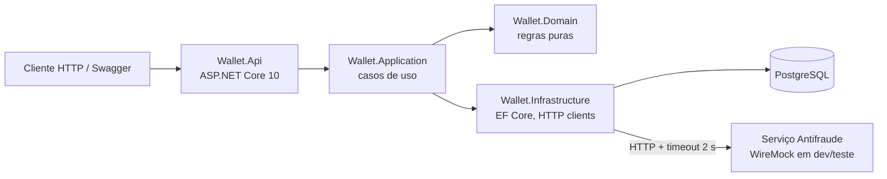
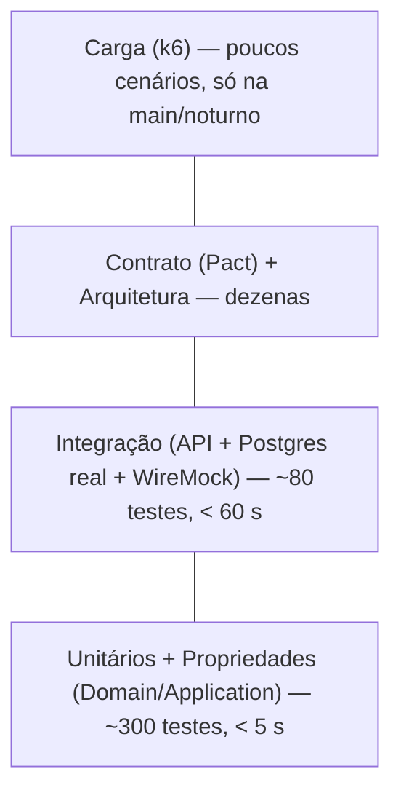
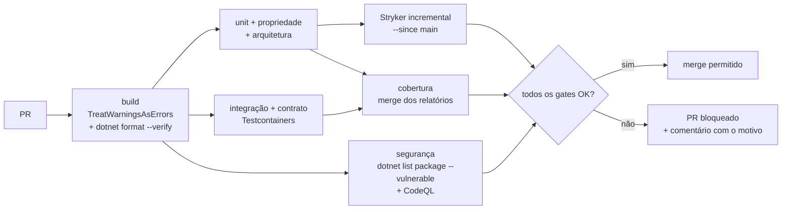

# Carteira Digital com Foco em Testes (C#) — Documentação do Projeto

> Projeto de portfólio: uma API de **carteira digital** (contas, depósitos, transferências, extrato) em **C# / ASP.NET Core 10**, com **PostgreSQL** e **Docker**. O produto em si é pequeno de propósito: o protagonista é a **estratégia de testes** e o **pipeline de CI/CD** que a garante.
>
> O que o projeto precisa mostrar é que eu sei **testar de verdade**: pirâmide de testes bem dividida, **testes de integração com banco real (Testcontainers)**, **testes de propriedade** (invariantes como "dinheiro não surge nem some"), **testes de mutação** (medir se os testes pegam bugs, não só cobertura), **testes de contrato**, **testes de arquitetura**, **testes de concorrência**, **testes de carga** e um **CI/CD com quality gates** que impede código ruim de chegar na `main`.

---

## 1. Objetivo

Construir uma API em que:

- O saldo seja sempre consistente: **a soma de todos os saldos é igual à soma de todos os depósitos menos os saques**, em qualquer cenário, inclusive com 1.000 transferências simultâneas.
- Uma transferência repetida (retry do cliente) **nunca debite duas vezes** (idempotência).
- Cada regra de negócio tenha teste, e os testes provem seu valor por meio de **mutation score**, não só de cobertura de linhas.
- O pipeline bloqueie o merge se: um teste falhar, a cobertura cair, o mutation score cair, a arquitetura for violada, uma vulnerabilidade for introduzida ou um contrato for quebrado.
- Cada merge na `main` gere uma **imagem Docker versionada** e uma **release** com changelog automático.

> **Contexto de avaliação:** sem deploy público. Quem for avaliar roda `docker compose up` (API + Postgres + Swagger), roda `dotnet test`, e principalmente **olha o CI**: badges, relatórios de cobertura e mutação publicados no GitHub Pages, comentários automáticos nos PRs.

### 1.1 Escopo do MVP

| Dentro | Fora (por enquanto) |
|---|---|
| Abertura de conta | KYC / validação de documentos |
| Depósito e saque (simulados) | Integração com Pix real |
| Transferência entre contas | Câmbio / várias moedas |
| Extrato paginado | Cartão de crédito |
| Idempotência e controle de concorrência | Investimentos |
| Consulta antifraude externa (simulada por WireMock) | Machine learning antifraude |
| Limites diários por conta | Limite noturno, limites por tipo |

---

## 2. Análise da stack

### 2.1 Por que um projeto "de testes"?

A maioria dos projetos de portfólio tem uma pasta `Tests` com meia dúzia de testes de "caminho feliz". Vagas de backend pleno/sênior perguntam sobre estratégia de testes, flakiness, testes de integração e qualidade de pipeline. Um domínio financeiro é ideal porque:

- As regras são claras e **verificáveis** (saldo, limites, idempotência).
- Bugs são graves e fáceis de entender ("cobrou duas vezes").
- Existem **invariantes** naturais, perfeitos para testes de propriedade.
- Concorrência é um problema real (duas transferências da mesma conta ao mesmo tempo).

### 2.2 Ferramentas de teste escolhidas

| Tipo | Ferramenta | Por quê |
|---|---|---|
| Framework | **xUnit v3** | Padrão do ecossistema .NET; suporte ao Microsoft Testing Platform; paralelismo |
| Asserções | **Shouldly** | Mensagens de erro legíveis; licença livre (o FluentAssertions passou a ter licença comercial na v8) |
| Dados de teste | **Bogus** + *builders* próprios | Dados realistas e builders legíveis (`AnAccount().WithBalance(100).Build()`) |
| Dublês | **NSubstitute** | Sintaxe simples; usado com moderação (seção 13.2) |
| Tempo | **`TimeProvider` + `FakeTimeProvider`** | Testar limite diário e expiração sem `Thread.Sleep` nem `DateTime.Now` |
| Integração com banco | **Testcontainers** (PostgreSQL) + **Respawn** | Banco real; Respawn limpa as tabelas entre testes em milissegundos |
| API em memória | **`WebApplicationFactory`** | Sobe a API inteira no processo de teste |
| Serviço externo | **WireMock.Net** | Simula o antifraude: lento, fora do ar, resposta inválida |
| Propriedade | **FsCheck** (integração com xUnit) | Gera milhares de sequências de operações e verifica invariantes |
| Snapshot | **Verify** | Aprova o formato das respostas da API e do OpenAPI; mudança acidental quebra o teste |
| Arquitetura | **ArchUnitNET** (ou NetArchTest) | "Domain não referencia Infrastructure", "Controllers não acessam DbContext" |
| Contrato | **PactNet** | Contrato consumidor ↔ provedor com o serviço antifraude |
| Mutação | **Stryker.NET** | Altera o código (`>` vira `>=`, remove linha) e verifica se algum teste falha |
| Carga | **k6** | Script JavaScript simples; métricas p95/p99; roda no CI com limites (thresholds) |
| Cobertura | **Microsoft.Testing.Extensions.CodeCoverage** + **ReportGenerator** | Coletor nativo do Microsoft Testing Platform (exigido pelo xUnit v3 no .NET 10); relatório HTML + resumo no PR |

### 2.3 Por que ASP.NET Core 10?

- Minimal APIs + `TypedResults` (fáceis de testar e de documentar).
- `TimeProvider` nativo, `IExceptionHandler`, `ProblemDetails` (RFC 9457), rate limiting e health checks prontos.
- Mesmo runtime do projeto Mensageria. Aqui o foco muda de tempo real para **qualidade**.

### 2.4 Por que PostgreSQL?

- Transações `SERIALIZABLE` ou `SELECT ... FOR UPDATE` para transferências.
- `CHECK (balance_cents >= 0)` como **última linha de defesa** contra saldo negativo.
- `UNIQUE` para idempotência.
- Testar contra Postgres real (Testcontainers) e não contra EF Core InMemory, que **não tem transações nem constraints** e dá falsa confiança (ADR 003).

### 2.5 Por que Docker?

- `docker compose up` sobe API + Postgres + Swagger.
- **Testcontainers** usa o Docker para criar um Postgres descartável em cada execução de testes de integração, na máquina e no CI.
- O teste de carga com k6 roda em container contra a API em container, isolado.

### 2.6 Limitações e prioridade no contexto do portfólio

| # | Limitação | Risco aqui | Tratamento |
|---|---|---|---|
| 1 | Testes lentos desestimulam rodar localmente | **Alto.** Suíte lenta vira suíte ignorada | Separação por categoria (unit < 5 s, integração < 60 s); um container Postgres compartilhado por coleção + Respawn |
| 2 | Testes intermitentes (flaky) | **Alto.** Destroem a confiança no CI | Proibido `Thread.Sleep`/`DateTime.Now`; `FakeTimeProvider`; ordem aleatória; job semanal que roda a suíte 20× e reporta testes instáveis |
| 3 | Mutation testing é lento | **Médio.** Stryker em todo o código pode levar muitos minutos | No PR, só nos arquivos alterados (`--since main`); completo toda noite |
| 4 | Cobertura alta com testes ruins | **Médio.** 90% de cobertura sem asserções úteis | Mutation score como gate principal; cobertura só como sinal |
| 5 | Teste de carga no CI é ruidoso | **Baixo.** Runners compartilhados variam | Thresholds folgados no CI; números "oficiais" medidos localmente e documentados |

---

## 3. Requisitos

### 3.1 Funcionais

| ID | Requisito |
|---|---|
| RF01 | Cliente abre uma conta (nome, CPF válido, e-mail). |
| RF02 | Cliente deposita valor (> 0, até R$ 50.000 por operação). |
| RF03 | Cliente saca valor, desde que tenha saldo. |
| RF04 | Cliente transfere para outra conta, desde que tenha saldo e não ultrapasse o limite diário (R$ 5.000 por padrão). |
| RF05 | Transferências acima de R$ 1.000 passam pelo serviço antifraude; se ele recusar, a transferência é negada. Se ele não responder em 2 s, a transferência fica "em análise". |
| RF06 | Toda operação de escrita aceita `Idempotency-Key`; repetir a requisição devolve o mesmo resultado sem repetir o efeito. |
| RF07 | Cliente consulta saldo e extrato paginado. |
| RF08 | Conta pode ser bloqueada (admin); conta bloqueada não envia nem recebe. |

### 3.2 Não funcionais

| ID | Requisito | Meta |
|---|---|---|
| RNF01 | Invariante de conservação | Soma dos saldos = soma das entradas − soma das saídas, sempre (teste de propriedade) |
| RNF02 | Sem saldo negativo | Garantido no código **e** no banco |
| RNF03 | Idempotência | 100% das operações de escrita |
| RNF04 | Cobertura de linhas | ≥ 90% em Domain e Application |
| RNF05 | Mutation score | ≥ 80% em Domain e Application (gate no CI) |
| RNF06 | Desempenho | Transferência p95 < 50 ms com 200 usuários virtuais (local) |
| RNF07 | Suíte unitária | < 5 s |
| RNF08 | Pipeline de PR | < 10 min |

---

## 4. Arquitetura

### 4.1 Visão geral



### 4.2 Estilo arquitetural

**Clean Architecture enxuta** (mesmas camadas do projeto Mensageria), porque ela tem uma vantagem importante para testes: **o domínio não depende de nada**, então a maioria das regras é testada sem banco, sem HTTP e sem mocks.

```
Wallet.Domain         → Account, Money (value object), Transfer, DailyLimitPolicy, erros de domínio
Wallet.Application    → TransferHandler, DepositHandler..., interfaces (IAccountRepository, IFraudCheck, IUnitOfWork)
Wallet.Infrastructure → EF Core (Postgres), FraudCheckHttpClient (Polly: timeout + retry), IdempotencyStore
Wallet.Api            → Minimal APIs, ProblemDetails, auth, OpenAPI
```

As regras de dependência **são testadas** (seção 13.6). Não ficam só no diagrama.

### 4.3 Estrutura de pastas

```
CarteiraDigital/
├── src/
│   ├── Wallet.Domain/
│   ├── Wallet.Application/
│   ├── Wallet.Infrastructure/
│   └── Wallet.Api/
├── tests/
│   ├── Wallet.Domain.Tests/              # unitários + propriedades (FsCheck)
│   ├── Wallet.Application.Tests/         # handlers com dublês
│   ├── Wallet.Integration.Tests/         # WebApplicationFactory + Testcontainers + WireMock
│   ├── Wallet.Contract.Tests/            # PactNet (consumidor do antifraude)
│   ├── Wallet.Architecture.Tests/        # ArchUnitNET
│   ├── Wallet.TestKit/                   # builders, fixtures, extensões compartilhadas
│   └── load/
│       └── transfer.js                   # k6
├── stryker-config.json
├── docker-compose.yml
├── Directory.Build.props                 # TreatWarningsAsErrors, nullable, analyzers
├── Directory.Packages.props              # versionamento central
├── .github/workflows/{ci.yml,mutation-nightly.yml,flaky-weekly.yml,release.yml}
├── README.md
└── PROJETO.md
```

---

## 5. Domínio e regras (o que está sendo testado)

### 5.1 Value object `Money`

```csharp
public readonly record struct Money
{
    public long Cents { get; }

    private Money(long cents) => Cents = cents;

    public static Money FromCents(long cents) =>
        cents < 0 ? throw new DomainException("Valor negativo não é permitido.") : new(cents);

    public static Money operator +(Money a, Money b) => new(checked(a.Cents + b.Cents));
    public static Money operator -(Money a, Money b) =>
        b.Cents > a.Cents ? throw new DomainException("Resultado negativo.") : new(a.Cents - b.Cents);

    public static bool operator >(Money a, Money b) => a.Cents > b.Cents;
    public static bool operator <(Money a, Money b) => a.Cents < b.Cents;
}
```

> Dinheiro em **centavos (`long`)**, nunca `double`. `0.1 + 0.2 != 0.3` em ponto flutuante. Isso tem um teste próprio só para documentar a decisão.

### 5.2 Transferência no domínio

```csharp
public sealed class Account
{
    public Guid Id { get; }
    public Money Balance { get; private set; }
    public AccountStatus Status { get; private set; }
    private readonly List<LedgerEntry> _entries = [];

    public Result Debit(Money amount, Guid transferId, DateTimeOffset now, DailyLimitPolicy limit)
    {
        if (Status == AccountStatus.Blocked) return Errors.AccountBlocked;
        if (amount.Cents == 0) return Errors.InvalidAmount;
        if (amount > Balance) return Errors.InsufficientFunds;
        if (!limit.Allows(this, amount, now)) return Errors.DailyLimitExceeded;

        Balance -= amount;
        _entries.Add(LedgerEntry.Debit(Id, amount, transferId, now));
        return Result.Ok();
    }
}
```

Cada `if` acima é um alvo do Stryker: se eu remover o `if` de conta bloqueada e nenhum teste falhar, o mutation score cai e o CI acusa.

### 5.3 Fluxo de transferência (Application + Infra)

```mermaid
sequenceDiagram
    participant C as Cliente
    participant API as API
    participant H as TransferHandler
    participant IDP as IdempotencyStore
    participant AF as Antifraude
    participant DB as Postgres

    C->>API: POST /transfers (Idempotency-Key: K)
    API->>IDP: já existe resultado para K?
    alt sim
        IDP-->>C: mesma resposta de antes
    else não
        API->>H: TransferCommand
        opt valor > R$ 1.000
            H->>AF: POST /check (timeout 2 s)
            AF-->>H: approved / denied / timeout
        end
        H->>DB: BEGIN; SELECT contas ... FOR UPDATE (ordem por Id)
        H->>H: debit / credit (domínio)
        H->>DB: INSERT ledger + resposta idempotente; COMMIT
        H-->>C: 201 Created
    end
```

- As duas contas são travadas **sempre na mesma ordem (por `Id`)**. Sem isso, A→B e B→A ao mesmo tempo causariam *deadlock*. Existe um teste específico para isso.
- A resposta idempotente é gravada **na mesma transação** da transferência.

### 5.4 Ledger (partidas dobradas)

Cada transferência gera **duas linhas** no `ledger_entries` (débito na origem, crédito no destino). O saldo é um valor materializado na conta para leitura rápida, mas sempre pode ser recalculado a partir do ledger. Isso permite um teste de **reconciliação**: `balance == SUM(credits) - SUM(debits)` para toda conta.

---

## 6. Modelo de dados (PostgreSQL)

```sql
CREATE TABLE accounts (
    id             uuid PRIMARY KEY,
    holder_name    varchar(120) NOT NULL,
    document       char(11)     NOT NULL UNIQUE,         -- CPF
    email          varchar(200) NOT NULL,
    balance_cents  bigint       NOT NULL DEFAULT 0 CHECK (balance_cents >= 0),
    status         smallint     NOT NULL DEFAULT 1,      -- 1 ativa, 2 bloqueada
    created_at     timestamptz  NOT NULL DEFAULT now(),
    xmin_version   xid          -- EF Core concurrency token (opcional)
);

CREATE TABLE transfers (
    id              uuid PRIMARY KEY,
    from_account_id uuid        NOT NULL REFERENCES accounts(id),
    to_account_id   uuid        NOT NULL REFERENCES accounts(id),
    amount_cents    bigint      NOT NULL CHECK (amount_cents > 0),
    status          smallint    NOT NULL,                -- 1 concluída, 2 negada, 3 em análise
    created_at      timestamptz NOT NULL DEFAULT now(),
    CHECK (from_account_id <> to_account_id)
);

CREATE TABLE ledger_entries (
    id            bigint GENERATED ALWAYS AS IDENTITY PRIMARY KEY,
    account_id    uuid        NOT NULL REFERENCES accounts(id),
    transfer_id   uuid,
    kind          smallint    NOT NULL,                  -- 1 crédito, 2 débito
    amount_cents  bigint      NOT NULL CHECK (amount_cents > 0),
    created_at    timestamptz NOT NULL
);
CREATE INDEX ix_ledger_account_time ON ledger_entries (account_id, created_at DESC, id DESC);

CREATE TABLE idempotency_keys (
    key            varchar(100) NOT NULL,
    account_id     uuid         NOT NULL,
    request_hash   char(64)     NOT NULL,                -- mesma chave com corpo diferente = 422
    response_code  int          NOT NULL,
    response_body  jsonb        NOT NULL,
    created_at     timestamptz  NOT NULL DEFAULT now(),
    PRIMARY KEY (account_id, key)
);
```

**Decisões de modelagem:**

- **`CHECK (balance_cents >= 0)`**: se um bug no código deixar passar um saque maior que o saldo, o banco recusa. Há um teste que **desliga a validação do domínio** (via reflexão/flag de teste) e verifica que o banco ainda segura.
- **`request_hash`** na idempotência: mesma chave com corpo diferente é erro do cliente (`422`), não "repetição".
- **Ledger imutável**: nunca `UPDATE`/`DELETE`. Correções são lançamentos de estorno.

---

## 7. Contratos da API

| Método | Rota | Descrição |
|---|---|---|
| `POST` | `/accounts` | Abrir conta |
| `GET` | `/accounts/{id}` | Saldo e dados |
| `POST` | `/accounts/{id}/deposits` | Depósito (`Idempotency-Key`) |
| `POST` | `/accounts/{id}/withdrawals` | Saque (`Idempotency-Key`) |
| `POST` | `/transfers` | Transferência (`Idempotency-Key`) |
| `GET` | `/accounts/{id}/statement?cursor=&limit=50` | Extrato (keyset) |
| `POST` | `/admin/accounts/{id}/block` | Bloquear conta |
| `GET` | `/health/live` · `/health/ready` | Health checks |

Erros em `application/problem+json` com `type` estável por regra (ex.: `.../errors/insufficient-funds`), testados por snapshot (Verify).

---

## 8. Estratégia de testes (o coração do projeto)

### 8.1 Pirâmide e orçamento de tempo



| Camada | Quantidade aprox. | Tempo | Roda quando |
|---|---|---|---|
| Unitário + propriedade | ~300 | < 5 s | Todo commit (local e CI) |
| Arquitetura | ~10 | < 2 s | Todo commit |
| Integração | ~80 | < 60 s | Todo PR |
| Contrato | ~10 | < 20 s | Todo PR |
| Mutação (incremental) | arquivos alterados | ~2–4 min | Todo PR |
| Mutação (completa) | tudo | ~15–30 min | Toda noite |
| Carga | 3 cenários | ~3 min | `main` + manual |

### 8.2 Testes unitários (Domain)

```csharp
public class AccountDebitTests
{
    private readonly FakeTimeProvider _time = new(new DateTimeOffset(2026, 11, 13, 12, 0, 0, TimeSpan.Zero));

    [Fact]
    public void Debit_with_insufficient_funds_fails_and_keeps_balance()
    {
        var account = AnAccount().WithBalance(cents: 10_00).Build();

        var result = account.Debit(Money.FromCents(10_01), Guid.NewGuid(), _time.GetUtcNow(), DailyLimitPolicy.Default);

        result.Error.ShouldBe(Errors.InsufficientFunds);
        account.Balance.Cents.ShouldBe(10_00);
    }

    [Theory]
    [InlineData(5_000_00, true)]    // exatamente no limite: permitido
    [InlineData(5_000_01, false)]   // 1 centavo acima: negado
    public void Daily_limit_boundary(long cents, bool allowed)
    {
        var account = AnAccount().WithBalance(cents: 10_000_00).Build();

        var result = account.Debit(Money.FromCents(cents), Guid.NewGuid(), _time.GetUtcNow(), DailyLimitPolicy.Default);

        result.IsSuccess.ShouldBe(allowed);
    }

    [Fact]
    public void Daily_limit_resets_at_midnight_in_sao_paulo()
    {
        // usa FakeTimeProvider.Advance para atravessar a meia-noite sem esperar
    }
}
```

> **Testes de borda** (exatamente no limite, 1 centavo acima) são os que matam mutantes do tipo `>` → `>=`.

### 8.3 Testes de propriedade (FsCheck)

Em vez de escolher exemplos à mão, o FsCheck gera **milhares de sequências aleatórias de operações** e verifica as invariantes depois de cada uma:

```csharp
[Property(MaxTest = 500)]
public Property Money_is_conserved_across_any_sequence_of_operations()
{
    return Prop.ForAll(Generators.OperationSequence(accounts: 5, maxOps: 200), ops =>
    {
        var bank = InMemoryBank.WithAccounts(5);
        foreach (var op in ops) bank.TryApply(op);       // operações inválidas simplesmente falham

        var totalBalances = bank.Accounts.Sum(a => a.Balance.Cents);
        var netFlow = bank.TotalDeposited - bank.TotalWithdrawn;

        return (totalBalances == netFlow).Label("conservação")
            .And(bank.Accounts.All(a => a.Balance.Cents >= 0)).Label("sem saldo negativo")
            .And(bank.Accounts.All(a => a.Balance.Cents == a.RecomputeFromLedger())).Label("ledger reconcilia");
    });
}
```

Quando uma propriedade falha, o FsCheck **reduz** (*shrinking*) o caso para a menor sequência que ainda falha, por exemplo "depositar 1 na conta A, transferir 1 de A para A". Esse tipo de bug dificilmente seria pego por exemplos escritos à mão.

### 8.4 Testes de integração (API + Postgres real)

```csharp
public sealed class ApiFactory : WebApplicationFactory<Program>, IAsyncLifetime
{
    private readonly PostgreSqlContainer _pg = new PostgreSqlBuilder().WithImage("postgres:18-alpine").Build();
    public WireMockServer FraudApi { get; } = WireMockServer.Start();
    private Respawner _respawner = default!;

    public async ValueTask InitializeAsync()
    {
        await _pg.StartAsync();
        // aplica migrations uma vez
        using var scope = Services.CreateScope();
        await scope.ServiceProvider.GetRequiredService<WalletDbContext>().Database.MigrateAsync();
        _respawner = await Respawner.CreateAsync(_pg.GetConnectionString(),
            new() { DbAdapter = DbAdapter.Postgres, TablesToIgnore = ["__EFMigrationsHistory"] });
    }

    public Task ResetAsync() => _respawner.ResetAsync(_pg.GetConnectionString());

    protected override void ConfigureWebHost(IWebHostBuilder builder) =>
        builder.UseSetting("ConnectionStrings:Postgres", _pg.GetConnectionString())
               .UseSetting("FraudApi:BaseUrl", FraudApi.Url)
               .ConfigureServices(s => s.AddSingleton<TimeProvider>(new FakeTimeProvider()));

    public new async ValueTask DisposeAsync() { FraudApi.Stop(); await _pg.DisposeAsync(); }
}
```

Exemplos de cenários:

| Cenário | Verifica |
|---|---|
| Mesma requisição com a mesma `Idempotency-Key` 3× | 1 transferência, 3 respostas idênticas, saldo debitado uma vez |
| Mesma chave, corpo diferente | `422` |
| Antifraude responde em 3 s (WireMock com `WithDelay`) | Transferência fica "em análise", nada é debitado |
| Antifraude retorna `500` duas vezes e depois `200` | Retry do Polly funciona |
| Conta bloqueada | `422` com `type` correto |
| Validação do domínio desligada + saque acima do saldo | Banco recusa pelo `CHECK` (defesa em profundidade) |

### 8.5 Testes de concorrência

```csharp
[Fact]
public async Task Concurrent_transfers_never_overdraw()
{
    var from = await Api.CreateAccountWithBalance(cents: 100_00);
    var to = await Api.CreateAccount();

    // 50 transferências de R$ 10 ao mesmo tempo, com saldo para só 10
    var results = await Task.WhenAll(Enumerable.Range(0, 50).Select(_ =>
        Client.PostAsJsonAsync("/transfers", new { from, to, amountCents = 10_00 },
            headers: Idempotency.NewKey())));

    results.Count(r => r.StatusCode == HttpStatusCode.Created).ShouldBe(10);
    (await Api.Balance(from)).ShouldBe(0);
    (await Api.Balance(to)).ShouldBe(100_00);
}

[Fact]
public async Task Opposite_transfers_do_not_deadlock()
{
    // A→B e B→A, 100 de cada, em paralelo: todas terminam (sem timeout de deadlock)
}
```

### 8.6 Testes de arquitetura

```csharp
private static readonly Architecture Arch = new ArchLoader()
    .LoadAssemblies(typeof(Account).Assembly, typeof(TransferHandler).Assembly,
                    typeof(WalletDbContext).Assembly, typeof(Program).Assembly).Build();

[Fact]
public void Domain_does_not_depend_on_other_layers() =>
    Types().That().ResideInNamespace("Wallet.Domain")
        .Should().NotDependOnAny(Types().That().ResideInNamespace("Wallet.Infrastructure")
            .Or().ResideInNamespace("Wallet.Api")
            .Or().ResideInNamespace("Microsoft.EntityFrameworkCore"))
        .Check(Arch);

[Fact]
public void Nobody_uses_DateTime_Now() =>   // força o uso de TimeProvider
    Types().Should().NotCallAny(MethodMembers().That().HaveFullNameContaining("System.DateTime::get_Now"))
        .Check(Arch);
```

### 8.7 Testes de contrato (Pact)

A carteira é **consumidora** do serviço antifraude. O teste de consumidor gera um arquivo de contrato (`wallet-fraudapi.json`) com as interações esperadas ("dado um valor de R$ 2.000, a resposta tem `decision` = `approved` | `denied`"). Num cenário real, o time do antifraude verificaria esse contrato no pipeline deles. Aqui, um **provedor fake** em `tests/` verifica o contrato para demonstrar o ciclo completo.

### 8.8 Snapshot (Verify)

- O documento OpenAPI gerado é comparado com `openapi.verified.json`. Qualquer mudança na API aparece no diff do PR e precisa ser aprovada conscientemente.
- Respostas de erro (`ProblemDetails`) também têm snapshot.

### 8.9 Testes de mutação (Stryker.NET)

```json
{
  "stryker-config": {
    "project": "Wallet.Domain.csproj",
    "test-projects": ["../../tests/Wallet.Domain.Tests/Wallet.Domain.Tests.csproj"],
    "mutation-level": "Advanced",
    "thresholds": { "high": 90, "low": 80, "break": 80 },
    "reporters": ["html", "json", "progress", "dashboard"],
    "since": { "enabled": true, "target": "main" }
  }
}
```

- `break: 80`: se menos de 80% dos mutantes forem "mortos", o comando falha e o PR é bloqueado.
- Exemplo de mutante que **sobrevive** sem um teste de borda: `if (amount > Balance)` → `if (amount >= Balance)`. O teste de "saque exatamente igual ao saldo" o mata.
- O relatório HTML é publicado no GitHub Pages, e o README mostra um print de um mutante sobrevivente e do teste que foi criado para matá-lo.

### 8.10 Testes de carga (k6)

```js
// tests/load/transfer.js
import http from "k6/http";
import { check } from "k6";

export const options = {
  scenarios: {
    transfers: { executor: "ramping-vus", stages: [{ duration: "30s", target: 200 }, { duration: "1m", target: 200 }] },
  },
  thresholds: {
    http_req_failed: ["rate<0.01"],
    "http_req_duration{name:transfer}": ["p(95)<50"],
  },
};

export default function () {
  const res = http.post(`${__ENV.API}/transfers`, JSON.stringify(randomTransfer()), {
    headers: { "Content-Type": "application/json", "Idempotency-Key": crypto.randomUUID() },
    tags: { name: "transfer" },
  });
  check(res, { "201 ou 422": (r) => r.status === 201 || r.status === 422 });
}
```

Depois da carga, um script verifica a **invariante de conservação** direto no banco. Desempenho sem consistência não vale nada.

---

## 9. CI/CD (quality gates)

### 9.1 Pipeline de PR



```yaml
# .github/workflows/ci.yml (trecho)
jobs:
  unit:
    runs-on: ubuntu-latest
    steps:
      - uses: actions/checkout@v4
      - uses: actions/setup-dotnet@v4
        with: { dotnet-version: "10.0.x" }
      - run: dotnet build -c Release /warnaserror
      - run: dotnet format --verify-no-changes
      - run: >
          dotnet test tests/Wallet.Domain.Tests tests/Wallet.Application.Tests tests/Wallet.Architecture.Tests
          -c Release --no-build --collect:"XPlat Code Coverage" --results-directory ./coverage
      - uses: actions/upload-artifact@v4
        with: { name: coverage-unit, path: coverage }

  integration:
    runs-on: ubuntu-latest          # Docker já disponível para o Testcontainers
    steps:
      - uses: actions/checkout@v4
      - uses: actions/setup-dotnet@v4
        with: { dotnet-version: "10.0.x" }
      - run: >
          dotnet test tests/Wallet.Integration.Tests tests/Wallet.Contract.Tests
          -c Release --collect:"XPlat Code Coverage" --results-directory ./coverage
          --logger "trx;LogFileName=integration.trx"
      - uses: dorny/test-reporter@v1          # testes falhos aparecem anotados no PR
        if: always()
        with: { name: Integration, path: "**/*.trx", reporter: dotnet-trx }

  mutation:
    needs: unit
    runs-on: ubuntu-latest
    steps:
      - uses: actions/checkout@v4
        with: { fetch-depth: 0 }             # o --since precisa do histórico
      - uses: actions/setup-dotnet@v4
        with: { dotnet-version: "10.0.x" }
      - run: dotnet tool restore
      - run: dotnet stryker --config-file stryker-config.json
        working-directory: src/Wallet.Domain

  coverage-gate:
    needs: [unit, integration]
    runs-on: ubuntu-latest
    steps:
      - uses: actions/download-artifact@v4
      - run: dotnet tool install -g dotnet-reportgenerator-globaltool
      - run: reportgenerator -reports:"**/coverage.cobertura.xml" -targetdir:report -reporttypes:"Html;MarkdownSummaryGithub;Cobertura"
      - run: ./scripts/check-coverage.sh report/Cobertura.xml 90 "Wallet.Domain,Wallet.Application"
      - uses: marocchino/sticky-pull-request-comment@v2
        with: { path: report/SummaryGithub.md }
```

### 9.2 Workflows agendados

| Workflow | Quando | O que faz |
|---|---|---|
| `mutation-nightly.yml` | Toda noite | Stryker completo em Domain + Application; publica o HTML no GitHub Pages e atualiza o badge |
| `flaky-weekly.yml` | Semanal | Roda a suíte de integração 20× com ordem aleatória; abre uma issue listando testes que falharam pelo menos uma vez |
| `load.yml` | `main` + manual | Sobe o compose, roda k6, verifica a invariante e publica o resumo |

### 9.3 Release (CD)

- **Conventional Commits** (`feat:`, `fix:`, `test:`) validados no PR.
- **release-please** abre um PR de release com o **CHANGELOG** gerado e o número de versão semântico.
- Ao fazer o merge do PR de release: build da imagem Docker (multi-stage, `chiseled` do .NET, usuário não-root), assinatura com **cosign**, geração de **SBOM**, push para o **GHCR** com tags `vX.Y.Z` e `latest`.
- **Branch protection** na `main`: exige todos os checks + 1 review (no projeto solo: o próprio autor, via PR, mantendo o histórico limpo).

---

## 10. Infraestrutura com Docker

```yaml
services:
  api:
    build: { context: ., dockerfile: src/Wallet.Api/Dockerfile }
    ports: ["8080:8080"]
    environment:
      ConnectionStrings__Postgres: Host=postgres;Database=wallet;Username=wallet;Password=${DB_PASSWORD}
      FraudApi__BaseUrl: http://fraud-mock:8080
    depends_on:
      postgres: { condition: service_healthy }

  fraud-mock:                       # WireMock standalone com mapeamentos versionados
    image: wiremock/wiremock:3.13.0
    volumes: ["./tests/wiremock:/home/wiremock:ro"]

  postgres:
    image: postgres:18-alpine
    environment: { POSTGRES_DB: wallet, POSTGRES_USER: wallet, POSTGRES_PASSWORD: "${DB_PASSWORD}" }
    healthcheck: { test: ["CMD-SHELL", "pg_isready -U wallet"], interval: 5s, retries: 10 }

  k6:
    image: grafana/k6
    profiles: ["load"]              # só sobe com: docker compose --profile load run k6
    command: run /scripts/transfer.js
    environment: { API: http://api:8080 }
    volumes: ["./tests/load:/scripts:ro"]
```

---

## 11. Segurança

| Ameaça | Mitigação | Teste |
|---|---|---|
| Transferir de conta de outra pessoa | Autorização: `from` precisa ser do usuário do token | Integração: `403` |
| Valores negativos ou zero | `Money` + validação + `CHECK` no banco | Unitário + propriedade |
| Repetição maliciosa da requisição | Idempotência com `request_hash` | Integração |
| Overflow de valor | `checked` na soma + limite por operação | Unitário com `long.MaxValue` |
| Dependência vulnerável | `dotnet list package --vulnerable` + Dependabot | CI |
| Código inseguro | CodeQL | CI |
| Imagem adulterada | cosign + SBOM | Release |

---

## 12. Observabilidade

- Logs estruturados (Serilog) com `transferId`, `accountId` e `idempotencyKey`.
- Métricas (OpenTelemetry): `wallet.transfers{status}`, `wallet.transfer.duration`, `wallet.fraud.timeouts`, `wallet.idempotency.replays`.
- Health checks com Postgres.
- Relatórios **de teste** são parte da observabilidade do projeto: tendência de cobertura e mutation score ao longo do tempo no GitHub Pages.

---

## 13. Boas práticas de teste adotadas (e documentadas no README)

1. **Nome do teste descreve o comportamento**: `Debit_with_insufficient_funds_fails_and_keeps_balance`.
2. **Arrange-Act-Assert** visível, com builders para o *arrange* não poluir o teste.
3. **Mocks só nas bordas**: o domínio é testado com objetos reais; dublês apenas para portas externas (antifraude, relógio). Mock demais testa a implementação, não o comportamento.
4. **Um motivo para falhar por teste**.
5. **Sem lógica no teste** (sem `if`/`for` nas asserções, exceto em testes de propriedade).
6. **Sem dependência de ordem**: ordem aleatória habilitada.
7. **Sem tempo real**: `FakeTimeProvider` em tudo.
8. **Banco real para o que depende de banco**: nada de EF InMemory.
9. **Testes como documentação**: a pasta `tests/Wallet.Domain.Tests/Rules` lê como uma especificação das regras de negócio.

---

## 14. Roadmap

### Fase 1 — Fundação
- [x] Solution, `Directory.Build.props` (nullable, analyzers, warnings como erro), `Directory.Packages.props`
- [x] Domínio (`Money`, `Account`, limites) com testes unitários
- [x] CI com build, formatação e testes unitários

### Fase 2 — API e integração
- [x] Minimal APIs + EF Core + migrations
- [x] `ApiFactory` com Testcontainers + Respawn
- [x] Idempotência + testes
- [x] Antifraude com Polly + WireMock

### Fase 3 — Testes avançados
- [ ] Propriedades com FsCheck (conservação, não negativo, reconciliação)
- [ ] Concorrência e deadlock
- [ ] Arquitetura (ArchUnitNET) e snapshot (Verify)
- [ ] Contrato (PactNet)
- [ ] Stryker no PR (incremental) e noturno (completo)

### Fase 4 — CD e apresentação
- [ ] Gates de cobertura e mutação com comentário no PR
- [ ] k6 + verificação da invariante após a carga
- [ ] release-please, imagem assinada no GHCR, SBOM
- [ ] Relatórios no GitHub Pages + badges
- [ ] Workflow de detecção de testes instáveis

### Ideias futuras
- Pix simulado com webhooks e testes de reentrega
- Testes de caos com Toxiproxy (latência e queda do Postgres)
- Comparar Stryker com mutation testing manual numa palestra/artigo

---

## 15. Registro de decisões (ADRs resumidos)

| # | Decisão | Alternativas | Motivo |
|---|---|---|---|
| 001 | Domínio pequeno e testes como protagonistas | Domínio grande | O objetivo é demonstrar estratégia de testes |
| 002 | xUnit v3 + Shouldly | NUnit, MSTest; FluentAssertions | Padrão de mercado; Shouldly com licença livre |
| 003 | Testcontainers com Postgres | EF Core InMemory, SQLite | InMemory não tem transações, constraints nem locks |
| 004 | Mutation score como gate principal | Só cobertura | Cobertura mede o que executa; mutação mede o que é verificado |
| 005 | Stryker incremental no PR | Completo em todo PR | Tempo de pipeline |
| 006 | FsCheck para invariantes | Só exemplos | Encontra combinações que ninguém pensaria em escrever |
| 007 | Dinheiro em centavos (`long`) | `decimal`, `double` | Exatidão e simplicidade; `double` é errado para dinheiro |
| 008 | Lock pessimista ordenado por Id | Concorrência otimista com retry | Comportamento previsível sob alta disputa; sem deadlock |
| 009 | Mocks só nas bordas | Mockar repositórios em todo lugar | Testes menos frágeis a refatorações |

---

## 16. O que destacar no README (para recrutadores)

1. **Badges**: CI, cobertura, **mutation score**, release.
2. **Tabela da pirâmide** com quantidade e tempo de cada camada (seção 8.1).
3. **Exemplo de bug encontrado pelo FsCheck** com o caso reduzido (*shrunk*).
4. **Print de um mutante sobrevivente** e o teste que o matou.
5. **Resultado do k6** + "invariante verificada após 30.000 transferências".
6. **Link para os relatórios** no GitHub Pages.
7. **"Como rodar"**: `docker compose up` e `dotnet test`.

### 16.1 Roteiro de demonstração (≈ 45 s)

1. Abrir um PR que muda `>` para `>=` na verificação de saldo.
2. Mostrar o CI: testes unitários passam (se faltar teste de borda), mas o **Stryker** acusa o mutante sobrevivente e bloqueia o merge.
3. Adicionar o teste de borda; o pipeline fica verde.
4. Mostrar o teste de concorrência: 50 transferências simultâneas, exatamente 10 aceitas.
5. Mostrar a release automática com changelog e a imagem no GHCR.

---

## 17. Referências

- [xUnit v3](https://xunit.net/) · [Shouldly](https://docs.shouldly.org/) · [NSubstitute](https://nsubstitute.github.io/) · [Bogus](https://github.com/bchavez/Bogus)
- [Testcontainers for .NET](https://dotnet.testcontainers.org/) · [Respawn](https://github.com/jbogard/Respawn) · [WireMock.Net](https://github.com/WireMock-Net/WireMock.Net)
- [FsCheck](https://fscheck.github.io/FsCheck/) · [Verify](https://github.com/VerifyTests/Verify) · [ArchUnitNET](https://github.com/TNG/ArchUnitNET) · [PactNet](https://github.com/pact-foundation/pact-net)
- [Stryker.NET](https://stryker-mutator.io/docs/stryker-net/introduction/) · [k6](https://grafana.com/docs/k6/latest/)
- [Integration tests in ASP.NET Core (WebApplicationFactory)](https://learn.microsoft.com/aspnet/core/test/integration-tests)
- [TimeProvider / FakeTimeProvider](https://learn.microsoft.com/dotnet/standard/datetime/timeprovider-overview)
- [release-please](https://github.com/googleapis/release-please) · [cosign](https://docs.sigstore.dev/cosign/overview/)
