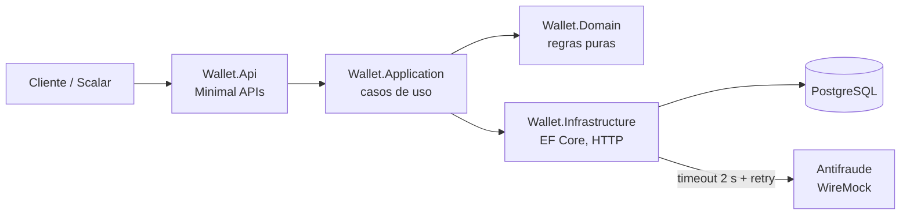
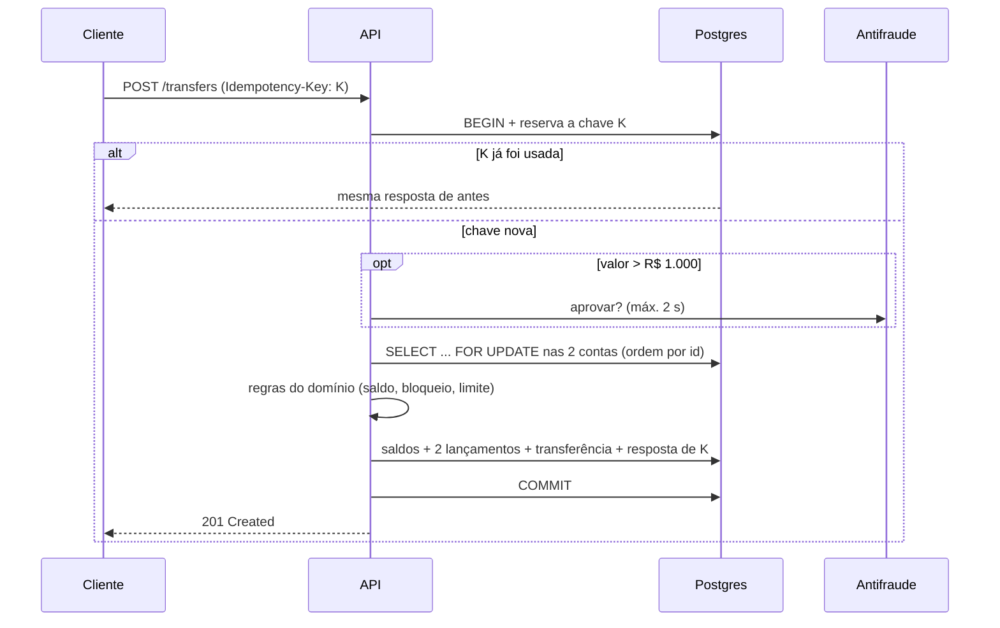

# 💰 Carteira Digital

> Uma carteira digital (contas, depósitos, saques e transferências) em **C# / .NET 10 + PostgreSQL**, onde o produto é pequeno de propósito e **o protagonista são os testes**.

[](https://github.com/MatheusBack/CarteiraDigital/actions/workflows/ci.yml)


Em sistemas financeiros, um bug não é "só um bug": é cobrar duas vezes, deixar saldo negativo ou perder dinheiro no caminho. Este projeto mostra como **provar** que isso não acontece: regras cobertas por testes, testes que pegam bugs de verdade (não só cobrem linhas), banco que se defende sozinho e um pipeline que impede código ruim de chegar na `main`.

---

## 📑 Sumário

- [Status](#-status)
- [Como rodar](#-como-rodar)
- [A API](#-a-api)
- [Regras de negócio](#-regras-de-negócio)
- [Como funciona](#-como-funciona)
- [Testes](#-testes)
- [Decisões técnicas](#-decisões-técnicas)
- [Estrutura do projeto](#-estrutura-do-projeto)
- [CI](#-ci)
- [Roadmap](#-roadmap)

---

## 🚦 Status

| Fase | O que entrega | Situação |
|---|---|---|
| **1. Fundação** | Domínio (dinheiro, contas, transferências, limites) + testes unitários + CI | ✅ Pronto |
| **2. API e integração** | API REST, PostgreSQL, idempotência, antifraude simulado, testes de integração | ✅ **Pronto** |
| 3. Testes avançados | Testes de propriedade, arquitetura, contrato, mutação | 📋 Planejado |
| 4. Entrega | Docker da API, teste de carga, release automática | 📋 Planejado |

O desenho completo (arquitetura, modelo de dados, estratégia de testes e decisões) está em **[PROJETO.md](PROJETO.md)**.

---

## 🚀 Como rodar

**Pré-requisitos:** [.NET 10 SDK](https://dotnet.microsoft.com/download/dotnet/10.0) e [Docker](https://www.docker.com/products/docker-desktop/).

### Testes

```bash
git clone https://github.com/MatheusBack/CarteiraDigital.git
cd CarteiraDigital

dotnet test
```

Os testes de integração sobem um **PostgreSQL de verdade em container** sozinhos (Testcontainers). Não é preciso configurar nada.

<details>
<summary><b>Sem Docker? Use um Postgres local</b></summary>

Aponte a variável `WALLET_TEST_POSTGRES` para um servidor Postgres. Cada execução cria um banco temporário e apaga no fim:

```bash
# bash
export WALLET_TEST_POSTGRES="Host=localhost;Port=5432;Username=postgres;Password=postgres"
# PowerShell
$env:WALLET_TEST_POSTGRES = "Host=localhost;Port=5432;Username=postgres;Password=postgres"

dotnet test
```

</details>

### API

```bash
docker compose up -d                  # Postgres + antifraude simulado
dotnet run --project src/Wallet.Api   # cria as tabelas na primeira execução
```

Abra **http://localhost:5080/scalar** para ver e testar todos os endpoints no navegador.

<details>
<summary><b>Outros comandos úteis</b></summary>

```bash
# só os testes unitários (rápidos, sem banco)
dotnet test --project tests/Wallet.Domain.Tests

# só os testes de integração
dotnet test --project tests/Wallet.Integration.Tests

# build com as mesmas regras do CI (avisos viram erros)
dotnet build -c Release

# verificar / corrigir formatação
dotnet format --verify-no-changes
dotnet format

# rodar só um grupo de testes
dotnet test --project tests/Wallet.Integration.Tests -- --filter-class "Wallet.Integration.Tests.IdempotencyTests"

# nova migration (depois de mudar o modelo)
dotnet tool restore
dotnet ef migrations add NomeDaMudanca -p src/Wallet.Infrastructure -s src/Wallet.Infrastructure -o Persistence/Migrations
```

</details>

---

## 🌐 A API

| Método | Rota | O que faz |
|---|---|---|
| `POST` | `/accounts` | Abre conta |
| `GET` | `/accounts/{id}` | Saldo e dados (CPF mascarado: `***.982.247-**`) |
| `GET` | `/accounts/{id}/statement?limit=50&cursor=` | Extrato, do mais recente para o mais antigo |
| `POST` | `/accounts/{id}/deposits` | Depósito 🔑 |
| `POST` | `/accounts/{id}/withdrawals` | Saque 🔑 |
| `POST` | `/transfers` | Transferência 🔑 |
| `GET` | `/transfers/{id}` | Consulta uma transferência |
| `POST` | `/admin/accounts/{id}/block` · `/unblock` | Bloqueia / desbloqueia |
| `GET` | `/health/live` · `/health/ready` | Health checks (o `ready` testa o banco) |

🔑 = exige o header **`Idempotency-Key`**.

### Exemplo

```bash
# 1. abrir duas contas
curl -s -X POST localhost:5080/accounts -H "Content-Type: application/json" \
  -d '{"holderName":"Maria","document":"529.982.247-25"}'
curl -s -X POST localhost:5080/accounts -H "Content-Type: application/json" \
  -d '{"holderName":"João","document":"111.444.777-35"}'

# 2. depositar 1.000 na Maria
curl -s -X POST localhost:5080/accounts/{idMaria}/deposits -H "Content-Type: application/json" \
  -H "Idempotency-Key: $(uuidgen)" -d '{"amount":1000}'

# 3. transferir 250 para o João
curl -s -X POST localhost:5080/transfers -H "Content-Type: application/json" \
  -H "Idempotency-Key: $(uuidgen)" \
  -d '{"fromAccountId":"{idMaria}","toAccountId":"{idJoao}","amount":250}'
```

Valores sempre em **reais, com até 2 casas decimais** (`150.75`).

### Erros

Todo erro sai em `application/problem+json` com um **`code` estável**:

```json
{
  "type": "https://github.com/MatheusBack/CarteiraDigital/blob/main/docs/erros.md#insufficient-funds",
  "title": "Saldo insuficiente.",
  "status": 422,
  "code": "insufficient-funds"
}
```

A lista completa, com o significado de cada código, está em **[docs/erros.md](docs/erros.md)**.

### 🔑 Idempotência: por que existe

O celular envia "transferir R$ 250", a rede cai e o app não sabe se deu certo. Se ele simplesmente reenviar, a Maria pode pagar duas vezes. Com a `Idempotency-Key`:

| Situação | Resposta |
|---|---|
| Primeira vez com a chave `K` | Executa e responde normalmente |
| Mesma chave `K`, mesmo corpo | **Mesma resposta**, sem executar de novo (header `Idempotency-Replayed: true`) |
| Mesma chave `K`, corpo diferente | `422 idempotency-key-reused` |
| 10 requisições simultâneas com `K` | Só uma executa. As outras esperam e recebem a mesma resposta |

A chave e a resposta são gravadas **na mesma transação** da operação: ou as duas coisas acontecem, ou nenhuma.

### 🕵️ Antifraude simulado

Transferências **acima de R$ 1.000** consultam um serviço antifraude externo (simulado com WireMock):

| Resposta do antifraude | Resultado | HTTP |
|---|---|---|
| Aprovada | Transferência concluída | `201` |
| Recusada | Registrada como `denied`, nada é movimentado | `422 transfer-denied` |
| Sem resposta em 2 s, ou erro | Registrada como `in_review`, nada é movimentado | `202` |

Erros passageiros (500/503) são retentados até 2 vezes. Com o `docker compose`, o mock **recusa valores acima de R$ 3.000** e **demora 3 s para exatamente R$ 1.777,00**. Assim dá para ver cada cenário na mão.

---

## 📏 Regras de negócio

Tudo abaixo está implementado e testado:

| Regra | Detalhe |
|---|---|
| 💵 **Dinheiro exato** | Valores em centavos (`long`). Nunca negativos. No máximo 2 casas decimais. |
| 🪪 **CPF válido** | Dígitos verificadores conferidos; um CPF por conta; devolvido mascarado. |
| ➕ **Depósito** | Maior que zero e até **R$ 50.000,00** por operação. |
| ➖ **Saque** | Maior que zero e até o saldo disponível. |
| 🔁 **Transferência** | Tudo ou nada: se qualquer regra falhar, **nenhuma** conta é alterada. |
| 📅 **Limite diário** | **R$ 5.000,00** por dia em transferências enviadas, contando o **dia de Brasília**. |
| 🕵️ **Antifraude** | Acima de R$ 1.000 a transferência precisa ser aprovada. |
| 🔑 **Idempotência** | Depósito, saque e transferência têm efeito no máximo uma vez por chave. |
| 🔒 **Conta bloqueada** | Não deposita, não saca, não envia e não recebe. |
| 📒 **Ledger** | Toda movimentação gera um lançamento imutável. O saldo sempre bate com a soma dos lançamentos. |

---

## ⚙️ Como funciona



O caminho de uma transferência:



- **Antifraude antes da trava:** uma chamada HTTP lenta nunca segura uma linha travada no banco.
- **Travas sempre na mesma ordem:** A→B e B→A ao mesmo tempo esperam uma pela outra em vez de travar para sempre (*deadlock*). Há um teste para isso.

### O banco também se defende

Se um bug passar pelo código, o PostgreSQL recusa:

| Proteção | Como |
|---|---|
| Saldo negativo | `CHECK (balance_cents >= 0)` |
| Lançamento com valor zero ou negativo | `CHECK (amount_cents > 0)` |
| Alterar um lançamento | Trigger que bloqueia `UPDATE` em `ledger_entries` |
| Duas contas com o mesmo CPF | Índice único |
| Transferência para si mesmo | `CHECK (from_account_id <> to_account_id)` |

---

## 🧪 Testes

| Camada | Projeto | Testes | Usa |
|---|---|---|---|
| Unitários | `Wallet.Domain.Tests` | **74** | Só o domínio: sem banco, sem HTTP, sem mocks (~3 s) |
| Integração | `Wallet.Integration.Tests` | **58** | API real em memória + **PostgreSQL real** + antifraude no WireMock |

### O que é testado

| Arquivo | Cobre |
|---|---|
| [`MoneyTests`](tests/Wallet.Domain.Tests/MoneyTests.cs) | Conversão, arredondamento, overflow, formato `R$ 1.234,56` |
| [`CpfTests`](tests/Wallet.Domain.Tests/Accounts/CpfTests.cs) | CPFs válidos e 11 tipos de CPF inválido |
| [`AccountTests`](tests/Wallet.Domain.Tests/Accounts/AccountTests.cs) | Abertura, depósito, saque, bloqueio e consistência do ledger |
| [`TransferServiceTests`](tests/Wallet.Domain.Tests/Transfers/TransferServiceTests.cs) | Transferência "tudo ou nada" e conservação do dinheiro |
| [`DailyLimitTests`](tests/Wallet.Domain.Tests/Transfers/DailyLimitTests.cs) | Limite exato, acumulado, virada de meia-noite e fuso horário |
| [`AccountsApiTests`](tests/Wallet.Integration.Tests/AccountsApiTests.cs) | Abertura, CPF duplicado, CPF mascarado, 404, health checks |
| [`MovementsApiTests`](tests/Wallet.Integration.Tests/MovementsApiTests.cs) | Depósito, saque, bloqueio, validações e extrato paginado |
| [`TransfersApiTests`](tests/Wallet.Integration.Tests/TransfersApiTests.cs) | Transferência ponta a ponta, destino bloqueado, limite diário |
| [`IdempotencyTests`](tests/Wallet.Integration.Tests/IdempotencyTests.cs) | Repetição, chave reaproveitada, 10 requisições simultâneas com a mesma chave |
| [`FraudCheckTests`](tests/Wallet.Integration.Tests/FraudCheckTests.cs) | Aprovação, recusa, timeout de 2 s, retry após 500/503 |
| [`DatabaseGuardsTests`](tests/Wallet.Integration.Tests/DatabaseGuardsTests.cs) | `CHECK` de saldo, ledger imutável, reconciliação saldo × lançamentos |
| [`ConcurrencyTests`](tests/Wallet.Integration.Tests/ConcurrencyTests.cs) | 20 saques simultâneos, transferências opostas sem deadlock |

### Os testes pegam bugs de verdade?

Cobertura alta não garante que os testes verificam alguma coisa. Para conferir, foram introduzidos **bugs de propósito** no código (teste de mutação manual) e rodada a suíte:

| Bug introduzido | Testes que falharam |
|---|---|
| Saque: `amount > Balance` virou `amount >= Balance` | 1 ✅ |
| Limite diário: `<=` virou `<` | 6 ✅ |
| Limite contado no dia **UTC** em vez do dia de Brasília | 2 ✅ |
| Removida a verificação de destino bloqueado | 1 ✅ |

Todos os bugs foram detectados. Na Fase 3, isso passa a ser automático com o **[Stryker.NET](https://stryker-mutator.io/)**.

### Boas práticas adotadas

- **Nome do teste descreve o comportamento**: `Concurrent_withdrawals_never_spend_more_than_the_balance`.
- **Testes de borda**: exatamente no limite e 1 centavo acima. São eles que pegam `>` trocado por `>=`.
- **Banco de verdade**: nada de banco "em memória". Constraints, travas e transações só existem no Postgres real.
- **Testes independentes**: o banco é limpo antes de cada teste ([Respawn](https://github.com/jbogard/Respawn)), então a ordem de execução não importa.
- **Mocks só nas bordas**: o único serviço falso é o antifraude externo (WireMock, via HTTP de verdade).
- **Sem relógio real no domínio**: tempo controlado com `FakeTimeProvider`.

---

## 🧠 Decisões técnicas

| Decisão | Por quê |
|---|---|
| **Centavos em `long`** | `0.1 + 0.2 != 0.3` em `double`. Inteiros são exatos e simples. Overflow é detectado (`checked`). |
| **`Result` para regras, exceção para bugs** | "Saldo insuficiente" é um resultado esperado, não uma exceção. |
| **Trava pessimista ordenada** (`FOR UPDATE`) | Comportamento previsível sob disputa e sem deadlock, em vez de "tentar de novo" com concorrência otimista. |
| **Idempotência no banco, na mesma transação** | Se a operação falhar no meio, a chave também é desfeita. Não existe "chave usada sem efeito". |
| **Antifraude fora da transação de saldo** | HTTP lento não pode segurar travas. Timeout total de 2 s com retry (Polly). |
| **Testcontainers em vez de banco em memória** | EF InMemory e SQLite não têm `FOR UPDATE`, `CHECK` com o mesmo comportamento nem triggers. |
| **Domínio mapeado direto no EF Core** | Sem classes de persistência duplicadas; o domínio continua sem referência ao EF. |
| **Problem Details com `code` estável** | Clientes dependem do código, não do texto. |
| **Avisos são erros** | Analisadores do .NET em nível recomendado + `TreatWarningsAsErrors`. |

---

## 📂 Estrutura do projeto

```
CarteiraDigital/
├── src/
│   ├── Wallet.Domain/            # regras de negócio puras (sem banco, sem HTTP)
│   ├── Wallet.Application/       # casos de uso, idempotência, interfaces
│   ├── Wallet.Infrastructure/    # EF Core + Postgres, migrations, cliente antifraude
│   └── Wallet.Api/               # Minimal APIs, Problem Details, OpenAPI
├── tests/
│   ├── Wallet.Domain.Tests/      # unitários
│   ├── Wallet.Integration.Tests/ # API + Postgres real + WireMock
│   └── wiremock/                 # respostas do antifraude simulado (docker compose)
├── docs/erros.md                 # catálogo de erros da API
├── .github/workflows/ci.yml      # pipeline de CI
├── docker-compose.yml            # Postgres + antifraude para rodar a API
├── Directory.Build.props         # regras de build para todos os projetos
├── Directory.Packages.props      # versões de pacotes centralizadas
├── dotnet-tools.json             # dotnet-ef e ReportGenerator
├── global.json                   # versão do SDK + Microsoft Testing Platform
└── PROJETO.md                    # documento de design completo
```

---

## 🔄 CI

A cada push e pull request, o [GitHub Actions](.github/workflows/ci.yml) roda:

1. **Build** em modo Release com avisos tratados como erros.
2. **Formatação** (`dotnet format --verify-no-changes`).
3. **Testes unitários**.
4. **Testes de integração** com Postgres em container.
5. **Cobertura combinada** (unitários + integração) com ReportGenerator, publicada no resumo da execução.
6. **Gate de cobertura**: falha se ficar abaixo de **90%** de linhas.

---

## 🗺️ Roadmap

**Fase 1: Fundação** ✅
- [x] Solution com build rigoroso e pacotes centralizados
- [x] `Money`, `Cpf`, `Account`, ledger e `TransferService`
- [x] Limite diário no fuso de Brasília
- [x] Testes unitários e CI com formatação e gate de cobertura

**Fase 2: API e integração** ✅
- [x] API REST (Minimal APIs) com erros em `application/problem+json`
- [x] PostgreSQL com EF Core, migrations e constraints de defesa
- [x] Idempotência (`Idempotency-Key`) na mesma transação da operação
- [x] Testes de integração com banco real (Testcontainers + Respawn)
- [x] Antifraude simulado com WireMock (timeout, retry, recusa)
- [x] Testes de concorrência básicos (saques simultâneos, transferências opostas)

**Fase 3: Testes avançados**
- [ ] Testes de propriedade com FsCheck ("dinheiro não surge nem some")
- [ ] Concorrência sob carga (50+ transferências simultâneas)
- [ ] Testes de arquitetura (ArchUnitNET) e snapshot (Verify)
- [ ] Testes de contrato com o antifraude (Pact)
- [ ] Testes de mutação automáticos (Stryker.NET) como gate no CI

**Fase 4: Entrega**
- [ ] Autenticação (cada cliente só movimenta a própria conta; rotas de admin protegidas)
- [ ] Dockerfile da API e compose completo
- [ ] Teste de carga com k6
- [ ] Release automática com changelog e imagem no GHCR

---

<p align="center">
  Feito como projeto de portfólio · Detalhes de arquitetura em <a href="PROJETO.md">PROJETO.md</a>
</p>
