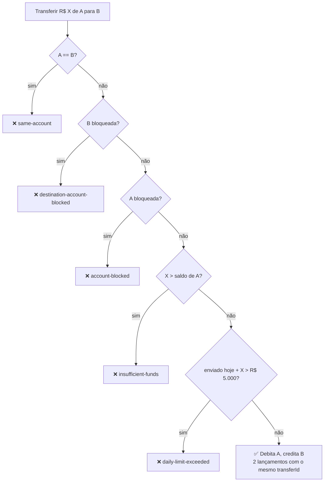

# 💰 Carteira Digital

> Uma carteira digital (contas, depósitos, saques e transferências) em **C# / .NET 10**, onde o produto é pequeno de propósito e **o protagonista são os testes**.

[](https://github.com/MatheusBack/CarteiraDigital/actions/workflows/ci.yml)


Em sistemas financeiros, um bug não é "só um bug": é cobrar duas vezes, deixar saldo negativo ou perder dinheiro no caminho. Este projeto mostra como **provar** que isso não acontece: regras cobertas por testes, testes que pegam bugs de verdade (não só cobrem linhas) e um pipeline que impede código ruim de chegar na `main`.

---

## 📑 Sumário

- [Status](#-status)
- [Como rodar](#-como-rodar)
- [Regras de negócio](#-regras-de-negócio)
- [Como funciona](#-como-funciona)
- [Testes](#-testes)
- [Decisões técnicas](#-decisões-técnicas)
- [Estrutura do projeto](#-estrutura-do-projeto)
- [CI](#-ci)
- [Roadmap](#-roadmap)

---

## 🚦 Status

| Fase | O que entrega | Situação |
|---|---|---|
| **1. Fundação** | Domínio (dinheiro, contas, transferências, limites) + testes unitários + CI | ✅ **Pronto** |
| 2. API e integração | API REST, PostgreSQL, idempotência, antifraude simulado | ⏳ Próxima |
| 3. Testes avançados | Testes de propriedade, concorrência, arquitetura, contrato, mutação | 📋 Planejado |
| 4. Entrega | Docker, teste de carga, release automática | 📋 Planejado |

O desenho completo (arquitetura, modelo de dados, estratégia de testes e decisões) está em **[PROJETO.md](PROJETO.md)**.

---

## 🚀 Como rodar

**Pré-requisito:** [.NET 10 SDK](https://dotnet.microsoft.com/download/dotnet/10.0). Só isso por enquanto: sem banco, sem Docker.

```bash
git clone https://github.com/MatheusBack/CarteiraDigital.git
cd CarteiraDigital

dotnet test
```

Saída esperada:

```
Resumo da execução de teste: Aprovado!
  total: 65
  falhou: 0
  duração: ~2s
```

<details>
<summary><b>Outros comandos úteis</b></summary>

```bash
# build com as mesmas regras do CI (avisos viram erros)
dotnet build -c Release

# verificar formatação (o CI falha se algo estiver fora do padrão)
dotnet format --verify-no-changes

# corrigir formatação automaticamente
dotnet format

# testes com relatório de cobertura (gera TestResults/coverage.cobertura.xml)
dotnet test -- --coverage --coverage-output-format cobertura --coverage-output coverage.cobertura.xml

# rodar só um grupo de testes
dotnet test -- --filter-class "Wallet.Domain.Tests.Transfers.DailyLimitTests"
```

</details>

---

## 📏 Regras de negócio

Tudo abaixo já está implementado e testado:

| Regra | Detalhe |
|---|---|
| 💵 **Dinheiro exato** | Valores em centavos (`long`). Nunca negativos. No máximo 2 casas decimais. |
| 🪪 **CPF válido** | Dígitos verificadores conferidos; aceita com ou sem pontuação; rejeita `111.111.111-11` e afins. |
| ➕ **Depósito** | Maior que zero e até **R$ 50.000,00** por operação. |
| ➖ **Saque** | Maior que zero e até o saldo disponível. Sacar exatamente o saldo é permitido. |
| 🔁 **Transferência** | Tudo ou nada: se qualquer regra falhar, **nenhuma** conta é alterada. |
| 📅 **Limite diário** | **R$ 5.000,00** por dia em transferências enviadas, contando o **dia de Brasília** (não o dia em UTC). |
| 🔒 **Conta bloqueada** | Não deposita, não saca, não envia e não recebe. |
| 📒 **Ledger** | Toda movimentação gera um lançamento imutável. O saldo sempre bate com a soma dos lançamentos. |

---

## ⚙️ Como funciona

Uma transferência passa por estas verificações, nesta ordem:



> **Por que o destino é verificado antes do débito?** Se a origem fosse debitada e só depois descobríssemos que o destino está bloqueado, o dinheiro sumiria. Existe um teste específico para essa ordem.

Exemplo de uso do domínio:

```csharp
var maria = Account.Open("Maria", Cpf.Parse("529.982.247-25"), now);
var joao  = Account.Open("João",  Cpf.Parse("111.444.777-35"), now);

maria.Deposit(Money.FromReais(1_000m), now);

var result = TransferService.Execute(
    from: maria, to: joao, amount: Money.FromReais(250m),
    transferId: Guid.NewGuid(), now: now, limit: DailyLimitPolicy.Default);

if (result.IsFailure)
    Console.WriteLine(result.Error!.Message);   // ex.: "Saldo insuficiente."

Console.WriteLine(maria.Balance);               // R$ 750,00
```

---

## 🧪 Testes

| Números | |
|---|---|
| Testes | **65** |
| Tempo | **~2 segundos** |
| Cobertura de linhas | **95%** |
| Cobertura de branches | **94%** |

### O que é testado

| Arquivo | Cobre |
|---|---|
| [`MoneyTests`](tests/Wallet.Domain.Tests/MoneyTests.cs) | Conversão, arredondamento, overflow, formato `R$ 1.234,56`, e por que `double` não serve para dinheiro |
| [`CpfTests`](tests/Wallet.Domain.Tests/Accounts/CpfTests.cs) | CPFs válidos e 11 tipos de CPF inválido |
| [`AccountTests`](tests/Wallet.Domain.Tests/Accounts/AccountTests.cs) | Abertura, depósito, saque, bloqueio e consistência do ledger |
| [`TransferServiceTests`](tests/Wallet.Domain.Tests/Transfers/TransferServiceTests.cs) | Transferência "tudo ou nada" e conservação do dinheiro |
| [`DailyLimitTests`](tests/Wallet.Domain.Tests/Transfers/DailyLimitTests.cs) | Limite exato, limite acumulado, virada de meia-noite e fuso horário |

### Os testes pegam bugs de verdade?

Cobertura alta não garante que os testes verificam alguma coisa. Para conferir, foram introduzidos **bugs de propósito** no código (teste de mutação manual) e rodada a suíte:

| Bug introduzido | Testes que falharam |
|---|---|
| Saque: `amount > Balance` virou `amount >= Balance` | 1 ✅ |
| Limite diário: `<=` virou `<` | 6 ✅ |
| Limite contado no dia **UTC** em vez do dia de Brasília | 2 ✅ |
| Removida a verificação de destino bloqueado | 1 ✅ |

Todos os bugs foram detectados. Na Fase 3, isso passa a ser automático com o **[Stryker.NET](https://stryker-mutator.io/)**.

### Boas práticas adotadas

- **Nome do teste descreve o comportamento**: `Withdraw_one_cent_above_the_balance_fails_and_keeps_balance`.
- **Testes de borda**: exatamente no limite e 1 centavo acima. São eles que pegam `>` trocado por `>=`.
- **Sem relógio real**: tempo controlado com `FakeTimeProvider` e horários fixos, nunca `DateTime.Now`.
- **Builders legíveis**: `AnAccount().WithBalance(100m).Blocked().Build()`.
- **Sem mocks no domínio**: as regras são testadas com objetos reais.

---

## 🧠 Decisões técnicas

| Decisão | Por quê |
|---|---|
| **Centavos em `long`** | `0.1 + 0.2 != 0.3` em `double`. Inteiros são exatos e simples. Overflow é detectado (`checked`). |
| **`Result` para regras, exceção para bugs** | "Saldo insuficiente" é um resultado esperado, não uma exceção. Já um valor negativo é erro de programação e lança `DomainException`. |
| **Ledger imutável** | O saldo pode ser auditado: sempre igual a créditos menos débitos. |
| **Dia de Brasília** | Às 22h em Brasília já é outro dia em UTC. Contar o limite pelo dia UTC permitiria enviar R$ 10.000 "no mesmo dia". |
| **Códigos de erro estáveis** | `insufficient-funds`, `daily-limit-exceeded`... A futura API e os testes dependem do código, não do texto. |
| **Avisos são erros** | Analisadores do .NET em nível recomendado + `TreatWarningsAsErrors`. Código com aviso não compila. |

---

## 📂 Estrutura do projeto

```
CarteiraDigital/
├── src/
│   └── Wallet.Domain/                 # regras de negócio puras (sem banco, sem HTTP)
│       ├── Money.cs                   # dinheiro em centavos
│       ├── Errors.cs                  # catálogo de erros de negócio
│       ├── Accounts/                  # Account, Cpf, LedgerEntry, DailyLimitPolicy
│       ├── Transfers/                 # TransferService
│       └── Common/                    # Result, Error, DomainException
├── tests/
│   └── Wallet.Domain.Tests/
│       ├── Builders/                  # AccountBuilder, TestClock
│       ├── Accounts/                  # testes de conta e CPF
│       └── Transfers/                 # testes de transferência e limite diário
├── .github/workflows/ci.yml           # pipeline de CI
├── Directory.Build.props              # regras de build para todos os projetos
├── Directory.Packages.props           # versões de pacotes centralizadas
├── global.json                        # versão do SDK + Microsoft Testing Platform
├── README.md                          # você está aqui
└── PROJETO.md                         # documento de design completo
```

---

## 🔄 CI

A cada push e pull request, o [GitHub Actions](.github/workflows/ci.yml) roda:

1. **Build** em modo Release com avisos tratados como erros.
2. **Formatação** (`dotnet format --verify-no-changes`).
3. **Testes** com coleta de cobertura.
4. **Gate de cobertura**: falha se ficar abaixo de **90%** de linhas.
5. **Artefatos**: resultados e relatório de cobertura ficam anexados à execução.

---

## 🗺️ Roadmap

**Fase 1: Fundação** ✅
- [x] Solution com build rigoroso e pacotes centralizados
- [x] `Money`, `Cpf`, `Account`, ledger e `TransferService`
- [x] Limite diário no fuso de Brasília
- [x] 65 testes unitários (95% de cobertura)
- [x] CI com formatação e gate de cobertura

**Fase 2: API e integração**
- [ ] API REST (Minimal APIs) com erros em `application/problem+json`
- [ ] PostgreSQL com EF Core e migrations
- [ ] Idempotência (`Idempotency-Key`)
- [ ] Testes de integração com banco real (Testcontainers)
- [ ] Antifraude simulado com WireMock

**Fase 3: Testes avançados**
- [ ] Testes de propriedade com FsCheck ("dinheiro não surge nem some")
- [ ] Testes de concorrência (50 transferências simultâneas)
- [ ] Testes de arquitetura (ArchUnitNET)
- [ ] Testes de contrato (Pact) e snapshot (Verify)
- [ ] Testes de mutação automáticos (Stryker.NET) como gate no CI

**Fase 4: Entrega**
- [ ] Docker Compose (API + Postgres)
- [ ] Teste de carga com k6
- [ ] Release automática com changelog e imagem no GHCR

---

<p align="center">
  Feito como projeto de portfólio · Detalhes de arquitetura em <a href="PROJETO.md">PROJETO.md</a>
</p>
